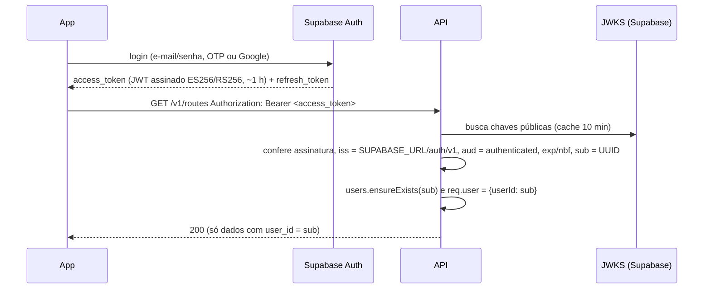

# Backend — Rota Max API v1

Conta **opcional**, backup e sincronização para o app offline-first. O app continua funcionando inteiro sem servidor e sem login; a API só entra quando o motorista cria conta.

Código: [`apps/api/`](../../apps/api). Contrato: [`docs/api/openapi.json`](../api/openapi.json). Sincronização: [`docs/api/sync-protocol.md`](../api/sync-protocol.md). DER: [`der.md`](der.md).

## 1. Visão geral

```text
App Flutter (SQLite, offline-first)
   │  login (opcional) ───────────────► Supabase Auth  (só URL + anon key no app)
   │                                         │ JWT (ES256/RS256)
   │  HTTPS /v1 + Bearer JWT                 ▼
   └──────────────────────────────────► NestJS API  (dona das regras)
                                             │ JWKS: ${SUPABASE_URL}/auth/v1/.well-known/jwks.json
                                             │ Prisma (pooler, porta 6543)
                                             ▼
                                      Supabase Postgres + PostGIS (RLS ligado)
```

Decisões:

| Decisão | Motivo |
|---|---|
| **NestJS + TypeScript** é a dona das regras de negócio | Uma camada só para validar dono, versão, máquina de estados e conflitos. O app nunca fala com o Postgres. |
| **Supabase** = Postgres + PostGIS + Auth (+ Storage depois) | Gerenciado, região `sa-east-1`, plano Free cobre o início. |
| **Prisma** é a única fonte de migrations | Um histórico só. PostGIS, CHECKs, índices parciais e RLS ficam em SQL dentro da migration. |
| **REST `/v1`** + OpenAPI | Simples para o app e para gerar cliente. |
| **Sem Redis, filas ou microsserviços** | Custo ~zero. Idempotência e ordem ficam no próprio Postgres (`sync_operations`, `sync_changes`, advisory lock). |

## 2. Módulos

| Módulo | Pasta | Responsabilidade |
|---|---|---|
| common | `src/common` | `@Public()`, `@CurrentUser()`, `JwtAuthGuard` (global), `HttpExceptionFilter` (formato único de erro), `AppException`, middleware `x-request-id`, interceptor de log, paginação, regras puras (`delivery-status.ts`, `geo.ts`). |
| config | `src/config/env.ts` | Variáveis validadas com zod na subida: `DATABASE_URL`, `DIRECT_URL`, `SUPABASE_URL`, `SUPABASE_JWT_AUDIENCE`, `PORT`, `CORS_ORIGINS`, `RATE_LIMIT_PER_MINUTE`. Falha cedo, sem imprimir valores. |
| auth | `src/auth/jwt-verifier.ts` | `JwtVerifier` injetável. Produção: `JoseJwtVerifier.forSupabase` (JWKS remoto com cache). Testes: par de chaves local. |
| persistence | `src/persistence` | Porta `Database`/`DataStore` (repositório genérico). `PrismaDatabase` (produção) e `MemoryDatabase` (testes). `EntityWriter`: versão, `field_versions`, exclusão lógica e log `sync_changes` em toda escrita. |
| users | `src/users` | `GET/PATCH /v1/me`; cria a linha em `users` no primeiro acesso (id = `sub`). |
| devices | `src/devices` | `POST /v1/devices` (upsert por id do aparelho; nunca troca de dono). |
| organizations | `src/organizations` | **Preparado**: tabelas e serviço de membros; sem endpoints na v1. |
| routes | `src/routes` | CRUD de rotas, paradas, reordenação (`route-operations.ts` é compartilhado com o sync). |
| deliveries | `src/deliveries` | Leitura/edição de entrega e eventos de status (`delivery-operations.ts` compartilhado com o sync). |
| optimization | `src/optimization` | `POST /v1/optimization/preview`: vizinho mais próximo + 2-opt sobre haversine × 1,3, respeitando trava/posição fixa. **Só lê.** |
| synchronization | `src/synchronization` | `POST /v1/sync/push` e `GET /v1/sync/pull`. |
| subscriptions | `src/subscriptions` | **Preparado**: `GET /v1/subscriptions/me` devolve o plano free. |
| payments | `src/payments` | **Vazio**: só a tabela. Nenhuma cobrança. |
| health | `src/health` | `GET /v1/health` público (ping no banco). |

## 3. Endpoints v1

| Método | Caminho | Descrição |
|---|---|---|
| GET | `/v1/health` | Público. `{status, database, version, time}`. |
| GET / PATCH | `/v1/me` | Perfil (nome, país, idioma, fuso). |
| POST | `/v1/devices` | Registra/atualiza aparelho. |
| GET / POST | `/v1/routes` | Lista paginada (`page`, `pageSize`, `status`) / cria (draft ou active). |
| GET / PATCH / DELETE | `/v1/routes/:id` | Detalhe com paradas / edita (status, origem, fim, estimativas; `baseVersion`) / exclusão lógica (`?withExclusiveDeliveries=true` exclui só entregas que não estão em outra rota). |
| POST | `/v1/routes/:id/stops` | Adiciona entregas existentes (`deliveryIds`) e/ou novas (`deliveries`). |
| PATCH | `/v1/routes/:id/stops/reorder` | Lista completa das paradas abertas, sem repetir (422 se não bate). |
| GET / PATCH | `/v1/deliveries/:id` | Detalhe / edição de dados (grava evento `edit`). *Extra em relação ao rascunho.* |
| POST | `/v1/deliveries/:id/events` | Troca de status (máquina do app) ou registro de edição. |
| POST | `/v1/optimization/preview` | Ordem proposta, sem gravar. |
| POST | `/v1/sync/push` | Lote ≤ 500 operações, idempotente. |
| GET | `/v1/sync/pull` | Mudanças depois do cursor, com tombstones. |
| GET | `/v1/subscriptions/me` | Plano atual (free). |

Padrões: corpo validado com `ValidationPipe({ whitelist, forbidNonWhitelisted, transform })`; erros `{statusCode, error, message, details?, path, timestamp, requestId}`; listas paginadas `{items, page, pageSize, total}`; rate limit global (120/min por IP, push 30/min); Swagger em `/docs` fora de produção.

## 4. Autenticação



- O guard é **global**; só `@Public()` escapa (hoje só `/v1/health`).
- O usuário vem **sempre** do `sub` do token. Nenhum DTO aceita `userId` (e `forbidNonWhitelisted` recusa o campo).
- Só algoritmos assimétricos (ES256/RS256/EdDSA). O projeto Supabase precisa usar **JWT Signing Keys** (padrão em projetos novos); o segredo HS256 legado não é aceito e nunca fica na API.
- Token expirado = 401 `TOKEN_EXPIRED` (o app renova com o refresh token pelo `supabase_flutter`).

## 5. Regras de segurança

1. **service_role nunca sai do servidor** — e a API nem precisa dela: usa a string de conexão do Postgres. O app só conhece `SUPABASE_URL` e a chave pública (`anon`/`publishable`) para o Auth.
2. **Dono por linha**: toda consulta filtra por `user_id = sub`. Recurso de outro usuário responde **404** (não revela que existe). Referências (`routeId`, `deliveryId`, `vehicleId`) também são checadas.
3. **RLS ligado em todas as tabelas** (defesa em profundidade). `anon`/`authenticated` perdem todos os privilégios; `authenticated` só tem `SELECT` com policy `user_id = auth.uid()` (organizações via `is_org_member`). Nenhuma escrita direta. A API conecta com o papel dono das tabelas (`postgres` no Supabase), que ignora RLS por ser dono (sem `FORCE ROW LEVEL SECURITY`). Opcional: criar um papel `rota_api` com `BYPASSRLS` e só os GRANTs necessários.
4. **Desligue a Data API (PostgREST)** do projeto no painel do Supabase, ou deixe só o schema `graphql_public`: o app não usa, e o RLS acima já impede escrita.
5. Validação estrita de entrada (class-validator + zod no sync), limites de tamanho (lote ≤ 500, textos com `maxLength`, `track` ≤ 200 KB).
6. Rate limit por IP (`trust proxy` atrás do host). Sem stack trace nem mensagem interna em 5xx.
7. Logs sem dados pessoais: método, rota sem query string, duração, `x-request-id`.
8. LGPD: projeto em `sa-east-1`; dados mínimos (nome do cliente, endereço, telefone do pedido); exclusão de conta = `DELETE` em `auth.users` → `ON DELETE CASCADE` em `users` e em tudo do usuário.
9. Segredos só em variáveis de ambiente do host. `.env` no `.gitignore`; `.env.example` sem valores.

## 6. Hospedagem com custo ~zero

### Supabase Free (banco + Auth)

Referência do plano Free (confira a página de preços antes de lançar; os números mudam):

| Recurso | Limite aproximado | Impacto no Rota Max |
|---|---|---|
| Banco | 500 MB por projeto | Entregas + eventos + log de sync. `track_points` não sobem (só o resumo). |
| Egress | ~5 GB/mês | Pull paginado e incremental; respostas JSON pequenas. |
| Auth | ~50 mil usuários ativos/mês | Folgado. |
| Storage | 1 GB | Não usado na v1 (comprovantes ficam para depois). |
| Conexões | pooler (Supavisor) com limite baixo | Usar porta 6543 com `pgbouncer=true&connection_limit=3`. |
| Pausa | projeto pausa após ~7 dias sem uso | Um ping diário em `/v1/health` (que faz `SELECT 1`) mantém ativo. |
| Backup | sem backup diário restaurável no Free | Exportar `pg_dump` semanal (GitHub Action com segredo) ou subir para Pro quando houver usuários pagantes. |

### Host Node (API)

Qualquer host com plano gratuito para um processo Node serve (a API é stateless, sem disco):

| Opção | Observação |
|---|---|
| Render (Free web service) | Simples, deploy pelo GitHub. Dorme após ~15 min sem tráfego (primeira chamada leva ~30–60 s); ~750 h/mês. Região mais próxima: EUA (latência maior até sa-east-1). |
| Google Cloud Run | Free tier mensal generoso de requisições/CPU; região `southamerica-east1` (perto do Supabase). Exige conta de faturamento. Escala a zero. |
| Koyeb / Fly.io | Verificar se ainda há franquia gratuita na conta. |

Como o app é offline-first, o "cold start" não atrapalha o motorista: o sync roda em segundo plano e tolera atraso.

Configuração no host:
- Build: `npm ci && npx prisma generate && npm run build`. Start: `npm run start:prod`.
- Variáveis: `NODE_ENV=production`, `DATABASE_URL` (pooler 6543), `DIRECT_URL` (5432, só para migration), `SUPABASE_URL`, `SUPABASE_JWT_AUDIENCE=authenticated`, `PORT` (o host injeta).
- Health check: `GET /v1/health`.
- Migrations: rodar `npx prisma migrate deploy` (com `DIRECT_URL`) no deploy, ou à mão antes de publicar uma versão que muda o banco.

### Checklist mensal da cota gratuita

- [ ] Supabase › Usage: tamanho do banco < 400 MB (80 %). Se passar, apagar `sync_operations` com mais de 90 dias e `sync_changes` já consumidos por todos os aparelhos (ver abaixo).
- [ ] Supabase › Usage: egress < 4 GB. Se subir, conferir se algum aparelho está em loop de pull (cursor não salvo).
- [ ] Supabase › Auth: usuários ativos no mês.
- [ ] Supabase › Logs: erros 5xx e conexões recusadas no pooler.
- [ ] Host: horas usadas no mês e memória (< 512 MB).
- [ ] `GET /v1/health` respondendo `database: up`; ping diário ativo (projeto não pausado).
- [ ] Backup manual/automático do mês feito e testado.
- [ ] Dependências: `npm audit` e CI verde.

Limpeza segura (manual, SQL no painel): `delete from sync_operations where received_at < now() - interval '90 days';` — o log `sync_changes` só pode ser podado até o menor cursor dos aparelhos ativos (guardar o cursor por aparelho é uma melhoria futura); até lá, não apagar.

## 7. Testes

- Unitários (`npm test`): guard JWT (válido, expirado, emissor/audience errados, sem token, outra chave, sub inválido, rota pública), dono (A não lê/altera rota de B → 404), reordenação, máquina de estados, idempotência do push (mesmo `operationId` 3× = aplicado 1×), conflitos por campo/status/exclusão, paginação do pull com tombstones, otimização que não grava nada.
- e2e (`npm run test:e2e`): sobe a API inteira com banco em memória e JWKS local: health público, 401 sem token, criar rota, adicionar paradas, reordenar, push duas vezes, pull paginado.
- Os serviços usam a mesma interface de dados nas duas implementações (Prisma e memória), então as regras testadas são as que rodam em produção. O SQL (RLS, CHECKs, índices parciais) só é exercitado num Postgres real: rodar a migration num projeto Supabase de teste antes do primeiro deploy.
