# DER — Postgres da API (Supabase)

Fonte da verdade: [`apps/api/prisma/schema.prisma`](../../apps/api/prisma/schema.prisma) + [`migration.sql`](../../apps/api/prisma/migrations/20261108000000_init/migration.sql).

Convenções: UUID em todas as chaves; `created_at`/`updated_at` em `timestamptz` (UTC); entidades sincronizadas têm `user_id`, `version`, `field_versions` e `deleted_at` (exclusão lógica). `location` é `geography(Point,4326)` **gerada** de `latitude`/`longitude`, com índice GIST.

```mermaid
erDiagram
    USERS ||--o{ DEVICES : tem
    USERS ||--o{ MEMBERSHIPS : participa
    ORGANIZATIONS ||--o{ MEMBERSHIPS : tem
    USERS ||--o{ SUBSCRIPTIONS : assina
    ORGANIZATIONS ||--o{ SUBSCRIPTIONS : assina
    PLANS ||--o{ SUBSCRIPTIONS : define
    SUBSCRIPTIONS ||--o{ PAYMENTS : gera

    USERS ||--o{ DELIVERIES : possui
    USERS ||--o{ ROUTES : possui
    USERS ||--o{ VEHICLES : possui
    USERS ||--o{ SHIFTS : possui
    USERS ||--o{ BASE_LOCATIONS : possui
    ROUTES ||--o{ ROUTE_STOPS : ordena
    DELIVERIES ||--o{ ROUTE_STOPS : "aparece em (1..n rotas)"
    DELIVERIES ||--o{ DELIVERY_EVENTS : historico
    ROUTES ||--o{ ROUTE_PLANS : economia
    VEHICLES ||--o{ OIL_CHANGES : manutencao
    VEHICLES |o--o{ SHIFTS : usado_em

    USERS ||--o{ SYNC_OPERATIONS : envia
    USERS ||--o{ SYNC_CHANGES : "log (cursor)"
    USERS ||--o{ AUDIT_LOGS : gera

    USERS {
        uuid id PK "= auth.users.id"
        text email
        text name
        char2 country
        text locale
        text timezone
        timestamptz deleted_at
    }
    DEVICES {
        uuid id PK "gerado no app"
        uuid user_id FK
        text platform
        text model
        text app_version
        timestamptz last_seen_at
        timestamptz revoked_at
    }
    ORGANIZATIONS {
        uuid id PK
        text name
        uuid owner_id
    }
    MEMBERSHIPS {
        uuid id PK
        uuid organization_id FK
        uuid user_id FK
        text role "owner|admin|driver"
    }
    PLANS {
        uuid id PK
        text code UK "free|pro"
        int price_cents
        jsonb limits
        bool is_active
    }
    SUBSCRIPTIONS {
        uuid id PK
        uuid user_id FK "ou organization_id"
        uuid plan_id FK
        text status
        timestamptz current_period_end
    }
    PAYMENTS {
        uuid id PK
        uuid subscription_id FK
        int amount_cents
        text status
        text provider
    }
    DELIVERIES {
        uuid id PK
        uuid user_id FK
        text order_number
        text package_id
        text customer_name
        text address
        text number
        text postal_code
        text city
        text state
        float latitude
        float longitude
        geography location "gerada, GIST"
        bool location_confirmed
        float value
        text priority
        text status "PENDING..SKIPPED"
        text failure_reason
        int attempts
        timestamptz delivered_at
        bigint version
        jsonb field_versions
        timestamptz deleted_at
    }
    ROUTES {
        uuid id PK
        uuid user_id FK
        text name
        text status "draft|active|completed"
        float origin_lat
        float origin_lng
        float end_lat
        float end_lng
        float estimated_km
        int estimated_minutes
        bool manually_edited
        timestamptz started_at
        timestamptz completed_at
        bigint version
        timestamptz deleted_at
    }
    ROUTE_STOPS {
        uuid id PK
        uuid user_id FK
        uuid route_id FK
        uuid delivery_id FK
        int position
        bool locked
        int fixed_position
        bigint version
        timestamptz deleted_at
    }
    DELIVERY_EVENTS {
        uuid id PK
        uuid user_id FK
        uuid delivery_id FK
        text kind "status|edit"
        text from_status
        text to_status
        text reason
        jsonb changed_fields
        float latitude
        float longitude
        timestamptz occurred_at
        uuid device_id
    }
    ROUTE_PLANS {
        uuid id PK
        uuid route_id FK
        int stops
        float baseline_km
        int baseline_minutes
        float optimized_km
        int optimized_minutes
    }
    VEHICLES {
        uuid id PK
        uuid user_id FK
        text name
        text type
        text fuel_type
        float km_per_liter
        float avg_speed_kmh
        float odometer_km
        bool is_active
    }
    OIL_CHANGES {
        uuid id PK
        uuid vehicle_id FK
        float odometer_km
        timestamptz changed_at
    }
    SHIFTS {
        uuid id PK
        uuid user_id FK
        uuid vehicle_id FK
        timestamptz started_at
        timestamptz ended_at
        float gps_km
        jsonb track "resumo: polyline, pontos, bbox"
    }
    BASE_LOCATIONS {
        uuid id PK
        uuid user_id FK
        text name
        text address
        geography location "gerada, GIST"
        bool is_default
    }
    SYNC_OPERATIONS {
        uuid id PK "= operation_id (idempotência)"
        uuid user_id
        uuid device_id
        text entity_type
        uuid entity_id
        text operation_type
        bigint base_version
        jsonb payload
        text status "applied|conflict|rejected"
        jsonb result
    }
    SYNC_CHANGES {
        bigserial seq PK "cursor do pull"
        uuid user_id
        text entity_type
        uuid entity_id
        bigint version
        text operation "upsert|delete"
    }
    AUDIT_LOGS {
        uuid id PK
        uuid user_id
        text action
        jsonb metadata
    }
```

## Índices e restrições que não aparecem no diagrama

- Únicos parciais: `route_stops(route_id, delivery_id) WHERE deleted_at IS NULL`; uma rota `active` e um veículo `is_active` por usuário.
- GIST: `deliveries(location)`, `base_locations(location)`.
- B-tree: `(user_id, updated_at)` em toda entidade sincronizada; `(user_id, status)` em entregas e rotas; `route_stops(route_id, position)`, `route_stops(delivery_id)`, `delivery_events(delivery_id, occurred_at)`, `sync_changes(user_id, seq)`, `created_at` nas tabelas grandes.
- CHECKs: status, prioridade, motivo de falha, tipo/combustível do veículo, papel na organização, status de assinatura/pagamento/sync, faixas de latitude/longitude.

## Diferenças em relação ao SQLite do app

| App (SQLite) | Servidor | Por quê |
|---|---|---|
| `id INTEGER` | `id uuid` gerado no aparelho | Sincronizar sem colisão entre aparelhos. O app ganha a coluna `uuid` (ver [sync-protocol.md](../api/sync-protocol.md#6-o-que-o-app-flutter-precisa-ganhar)). |
| sem dono | `user_id` em toda tabela (inclusive filhas) | RLS simples e pull por usuário sem join. |
| `track_points` (uma linha por ponto) | `shifts.track` jsonb (resumo) | Custo: milhares de pontos por turno estourariam o plano Free. |
| `base_location` (uma linha, id = 1) | `base_locations` por usuário, `is_default` | Vários aparelhos/pontos; sem id fixo. |
| `routes` apagada de verdade | exclusão lógica (tombstone) | Outros aparelhos precisam saber da exclusão. |
| `delivery_events.created_at` | `occurred_at` (no aparelho) + `created_at` (no servidor) + `device_id` | Separar quando aconteceu de quando chegou. |
| `changed_fields` texto com vírgulas | `jsonb` array | Consulta e validação. |
| `geocode_cache`, `settings`, `error_log` | não existem | Locais do aparelho. |
